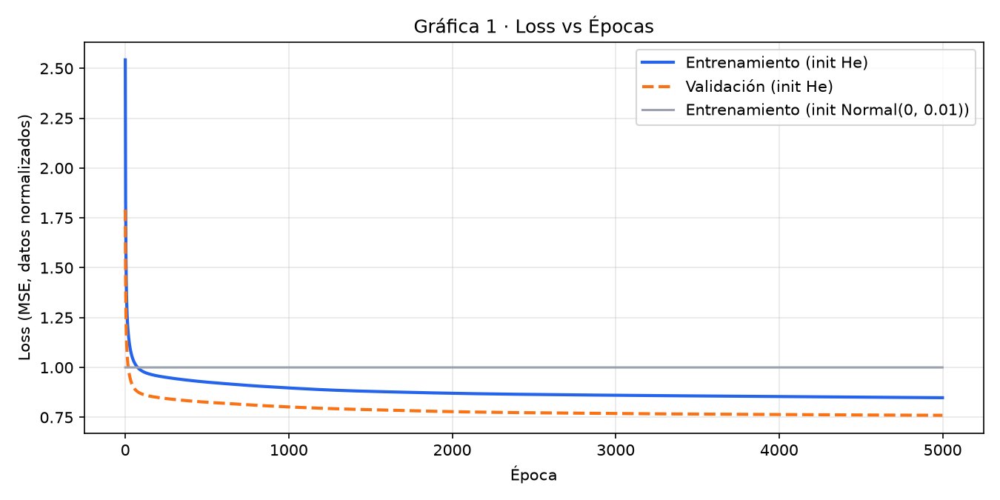
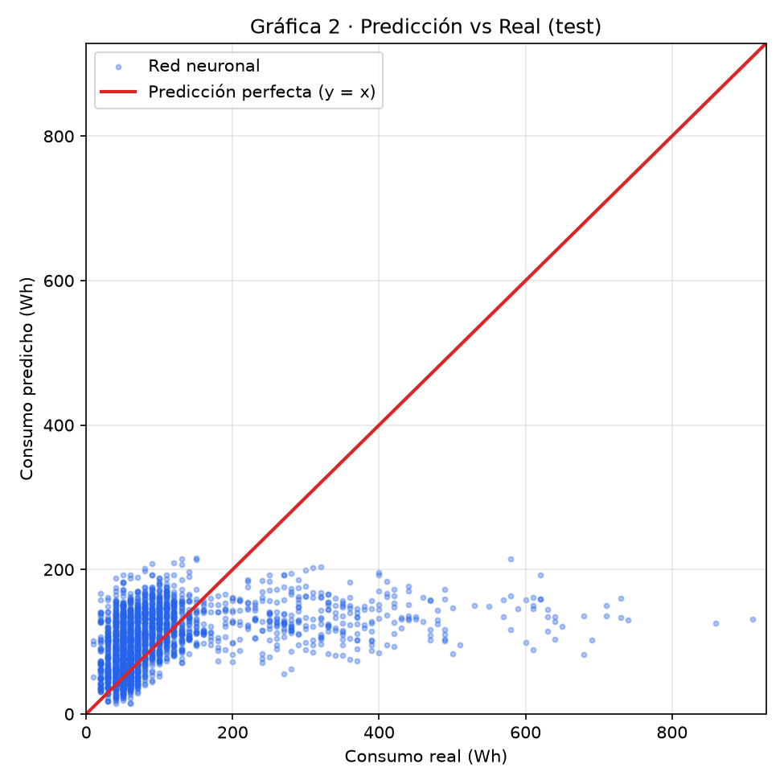
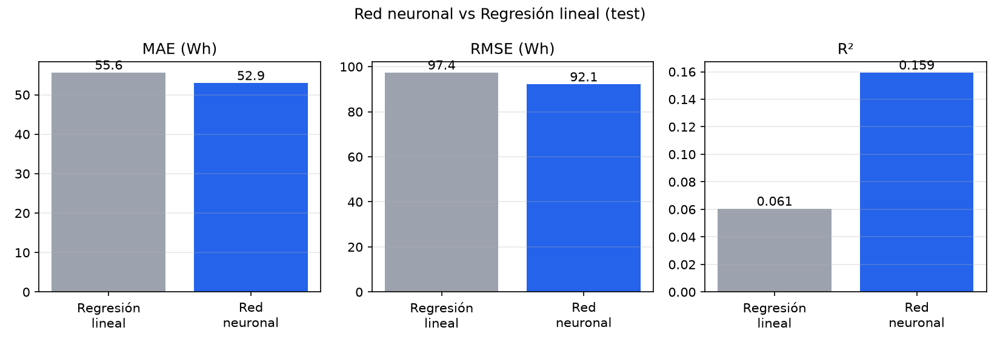

# Red neuronal multicapa: predicción de consumo energético

Red neuronal programada **desde cero con NumPy** (sin TensorFlow, Keras ni PyTorch) que predice el consumo eléctrico de los electrodomésticos de una casa a partir de la hora, el día y el clima.

**Proyecto final de Seminario de Sistemas II.** Raúl Hernández Nuñez · Matrícula 2173770 · IAS · Grupo 002

🌐 **Página del proyecto:** _pendiente (Vercel)_

---

## El problema

Los edificios consumen alrededor del **30 % de la energía mundial** y generan el **27 % de las emisiones de CO₂**. Predecir cuánta energía se va a consumir ayuda a planear mejor y a desperdiciar menos (ODS 7 y ODS 13).

## Los datos

[UCI Appliances Energy Prediction](https://archive.ics.uci.edu/dataset/374/appliances+energy+prediction): 19,735 mediciones cada 10 minutos de una casa en Bélgica (enero a mayo de 2016). El notebook descarga el dataset solo; no está incluido en este repositorio.

| Entradas (6) | Objetivo |
|---|---|
| `hour`, `dayofweek`, `is_weekend`, `month` (derivadas de la fecha), `T_out` (temperatura exterior) y `RH_out` (humedad exterior) | `Appliances`: consumo en **Wh** |

División aleatoria 70 / 15 / 15 (entrenamiento / validación / prueba) con normalización z-score calculada solo con el set de entrenamiento.

## La red

```
6 entradas → 16 (ReLU) → 8 (ReLU) → 1 (lineal) = consumo en Wh
```

| Parámetro | Valor |
|---|---|
| Loss | MSE |
| Optimización | Backpropagation manual + gradient descent (batch completo) |
| Learning rate | 0.01 |
| Épocas | 5000 |
| Inicialización | He (`Normal(0, √(2/n))`) |
| Semilla | 42 |

Un *gradient check* compara las derivadas del backpropagation contra una aproximación numérica para comprobar que son correctas. La inicialización `Normal(0, 0.01)` del plan original no aprende (el loss se queda en ≈ 1.0); el notebook entrena las dos para mostrarlo.

## Resultados (set de prueba)

| Modelo | MAE (Wh) | RMSE (Wh) | R² |
|---|---|---|---|
| Red neuronal [6, 16, 8, 1] | _pendiente_ | _pendiente_ | _pendiente_ |
| Regresión lineal (scikit-learn) | _pendiente_ | _pendiente_ | _pendiente_ |







**Lectura honesta:** con solo 6 variables de tiempo y clima exterior, el R² es bajo. El consumo depende sobre todo de lo que hacen las personas (cuándo cocinan, lavan, etc.), que no está en los datos, y tiene picos muy altos e impredecibles.

## Cómo correrlo

**En Google Colab (sin instalar nada):** sube `notebooks/red_neuronal.ipynb` en [colab.research.google.com](https://colab.research.google.com) y elige *Runtime → Run all*.

**En local:**

```bash
python -m venv .venv
.venv\Scripts\activate          # Windows  (macOS/Linux: source .venv/bin/activate)
pip install -r requirements.txt
jupyter lab notebooks/red_neuronal.ipynb
```

**La página web** (React + Vite + Recharts + Tailwind) lee `web/src/data/resultados.json`, que genera el notebook:

```bash
cd web
npm install
npm run dev        # http://localhost:5173
```

Más detalle en [docs/INSTALACION.md](docs/INSTALACION.md).

## Estructura

```
notebooks/red_neuronal.ipynb   Notebook principal: datos, red, entrenamiento, métricas y gráficas
codigo/red_neuronal.py         La clase NeuralNetwork sola
resultados/                    Gráficas, metricas.txt y resultados.json (salen del notebook)
web/                           Página en React
docs/                          Plan de trabajo e instalación
```
